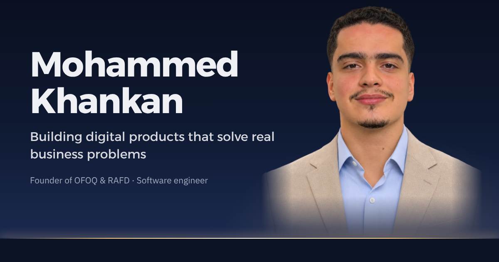

# khankan-portfolio

Source for my personal site: **[mohammedkhankan.ofoqsy.com](https://mohammedkhankan.ofoqsy.com/en/)**



Bilingual (Arabic RTL / English LTR) portfolio with case studies for RUKN, OFOQ Restaurant OS, MAAZEEM, RAFD and AL TAYF. It's a static export: every page is generated at build time, so there's no server, database or tracking.

## Run

```bash
npm install
npm run dev          # http://localhost:3000  (development)
npm run build        # production build → ./out
npm start            # serve ./out locally on :3000
npm run typecheck && npm run lint
```

Requires Node 20+.

## Stack

Next.js 16 (App Router, `output: "export"`), React 19, TypeScript, Tailwind CSS 4, self-hosted fonts (Readex Pro, IBM Plex Sans Arabic, JetBrains Mono), `sharp` for the image pipeline. No database, backend, CMS, analytics or paid services.

## Structure

```
src/
  app/
    [locale]/            /ar and /en — layout (html lang/dir), pages
      page.tsx           Home
      about/ experience/ contact/ privacy/
      projects/          Index + [slug] case studies (generated from content)
    page.tsx             "/" → saved language → browser language → Arabic
    sitemap.ts robots.ts not-found.tsx globals.css (design tokens)
  content/
    site.ts              Name, links, portrait flag, all UI strings (AR/EN)
    pages.ts             Copy for Home / About / Experience / Contact / Privacy
    projects/*.ts        One file per project (shared typed model in types.ts)
  components/            Header, Footer, Gallery (lightbox), Media, Diagrams, …
  lib/                   i18n, SEO, fonts, media manifest loader
assets-src/<slug>/       Source images you drop in (not shipped)
public/projects/<slug>/  Optimized WebP variants + manifest.json (generated)
scripts/                 optimize-images.mjs, og.mjs
public/_headers          Security & cache headers (Netlify / Cloudflare Pages)
```

## Edit text

All copy lives in `src/content/` — `site.ts` (UI, name, links), `pages.ts` (page copy), `projects/<slug>.ts` (case studies). Every string is `{ ar, en }`. No component changes needed.

## Add a project

1. Copy any file in `src/content/projects/` to `<new-slug>.ts` and fill in the fields.
2. Import it in `src/content/projects/index.ts`.
3. (Optional) add images — see below.

Its page, cards, footer link, sitemap entry and "next project" link are created automatically. To add a diagram, add a key to `DiagramKey` in `types.ts` and an entry in `components/Diagrams.tsx`.

## Images (all projects)

1. Put PNG/JPG/WebP files in `assets-src/<slug>/` (e.g. `assets-src/rukn/`). File order = display order (prefix `01-`, `02-` …).
2. Optional `assets-src/<slug>/meta.json` for alt text and roles:
   ```json
   { "01-dashboard.png": { "alt": { "ar": "لوحة التحكم", "en": "Dashboard" }, "role": "hero" } }
   ```
   Without it, alt text comes from the file name and the first landscape image becomes the hero.
3. `npm run images` → WebP at 640/1280/1920, blur placeholders, `manifest.json`, OG images.
4. `npm run build`.

Projects without images show a placeholder that lists the expected screens.

To replace a project's images, empty `assets-src/<slug>/`, add the new set, then run `npm run images -- <slug>` and `npm run build`. Finance screenshots (RAFD) use redacted or sample data only.

### Portrait
`assets-src/portrait/original.png` → `npm run images` (4:5 crop, light sharpening). Set `person.portrait = false` in `site.ts` to fall back to a monogram.

## Deploy

Hosted on GitHub Pages from the `gh-pages` branch. Set `NEXT_PUBLIC_SITE_URL` (canonical URLs, hreflang, sitemap, OG), run `npm run build`, and publish `out/`. `public/_headers` carries the security headers for hosts that support it (Netlify, Cloudflare Pages).
